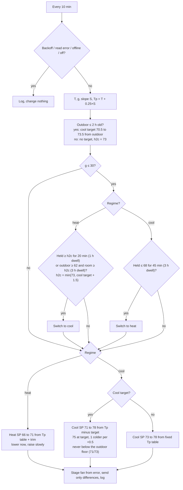

# Mitsubishi Mini-Split Controller: an experimental alternative to Auto mode

An unofficial, experimental Python controller for Mitsubishi mini-split heat pumps on Kumo Cloud and the Mitsubishi Comfort app. Instead of Auto mode's heat/cool changeover, it keeps the unit in heat, steers the setpoint toward 70°F from a 15-minute temperature prediction, and cools only when sun pushes the room to 73°F or more (as low as 72°F on cold days when outdoor data is configured).

**Status: experimental.** It runs daily in the author's home but has not yet proven steadier than a simpler approach there. Treat it as a starting point and check your own log.

In the author's own trial, this version has not yet beaten an earlier, simpler version (roughly 44% vs 71% of time in band). Strong afternoon sun also pushed the room above the band.

It talks to the same cloud backend as the Mitsubishi Comfort app (Kumo Cloud v3) through a bundled client, runs every 10 minutes on any always-on machine with Python 3.11+, and writes a CSV log so you can check your own results. Not affiliated with Mitsubishi Electric.


## The problem

Mitsubishi's Auto mode keeps a heat setpoint and a cool setpoint and only changes mode when the room crosses the other one. A 67/73 Auto (the defaults `scripts/restore.sh` puts back) is not trying to hold a 69 to 71°F band at all: in the same simulation it spends 73% of the day below 69°F. A fair comparison sets Auto to 70/72, aimed at the band, and that is what Chart 1 shows. In that simulation both hold the band about equally (75% for Stock Auto, 77% for the controller); the difference is cooling. Stock Auto switches to cooling as soon as afternoon sun takes the room past 72°F and cools for 4.2 hours, while the controller stays in heat until the room holds 73°F and cools for 2.7 hours. The trade-off is a warmer afternoon: the controller peaks near 74.0°F against about 72.9°F for Stock Auto.

## How it works

The controller stays in heat and steers the heat setpoint between 66 and 71°F from a predicted room temperature 15 minutes ahead (Tp = current temp + 0.25 h × slope). It lowers the setpoint right away when Tp says the room is heading up, and raises it at most 1°F per 15 minutes. Every 3 hours it compares the time-weighted mean with the 70°F target and trims the whole table by 1°F if the mean drifted more than 0.4°F. It only cools when the room holds at or above 73°F for 20 minutes, which in practice means solar gain. With a fresh outdoor reading (at most 2 hours old) that entry point drops to the cool target + 1.5°F when that is lower, and the cool setpoint follows an outdoor-adaptive cool target: 70.5°F when it is 55°F or colder outside, rising linearly to 73.5°F at 80°F or warmer. The cool setpoint is 75 when Tp is at the target and 1°F colder for each 0.5°F above it, down to 71; it steps down at most once per 15 minutes, by 2°F when Tp is more than 1.5°F over the target. Without outdoor data it uses the fixed cool table. The fan is staged from how far the room is from where it should be (quiet up to superPowerful) instead of sitting on auto.

It runs every 10 minutes, sends only the settings that differ from the unit's live state, never touches the vane, never turns a switched-off unit back on, and writes one row per cycle to a CSV log.



T is the wireless sensor reading if it is at most 20 minutes old, else the unit's own reading. g is the number of minutes since the last good reading; after a gap longer than 30 minutes the controller still follows T but skips the slope, regime switches and trim.


## What to expect


Charts are a simulation that shows the behavior. Your results depend on your room, unit and climate.

The simulation (`scripts/simulate.py`) runs a simple one-room thermal model for 24 hours under the same outdoor temperature and sun curves twice. Both runs use the same modulating indoor unit (a PI loop with a minimum output that cycles off past its setpoint): once with Stock Auto at 70/72°F and its own changeover, and once driven by this controller's real decision code. Chart 3 adds a 67/73 Auto run for reference; it is not aimed at the band. The afternoon sun is calibrated to the 74.3°F afternoon peak in the author's real log, recorded with the earlier, milder cool table; with the current table the simulated peak is about 74.0°F. The simulated controller gets no outdoor reading, so it runs on the fixed cool table and the 73°F entry point, exactly as an install without `MSC_LATITUDE` / `MSC_LONGITUDE` would. The dynamics use no random numbers; the seed (42) only adds display noise, so `python scripts/make_charts.py` redraws identical charts every time.

Overnight the controller toggles its heat setpoint between 69 and 70°F about every 30 minutes, because the predicted temperature sits right on a table threshold. The unit only sees a 1°F nudge each time, so the room stays steady.

## Quick start

You need a Mitsubishi Comfort app account with the unit already set up in the app, and Python 3.11 or newer. Run these from the repository root: the default `MSC_CLIENT_CMD` is `python3 client/mitsubishi.py`, a relative path.

```bash
git clone https://github.com/chrisperish/mitsubishi-mini-split-controller.git
cd mitsubishi-mini-split-controller
python3 -m venv .venv && . .venv/bin/activate
pip install -e .
minisplit-controller --help

export MITSUBISHI_COMFORT_EMAIL="you@example.com"
export MITSUBISHI_COMFORT_PASSWORD="..."
python3 client/mitsubishi.py login              # store cloud tokens
python3 client/mitsubishi.py status             # find your unit's serial or name
export MSC_DEVICE="Living Room"                 # your unit's serial or name
minisplit-controller --once --dry-run           # decide and print, change nothing
```

Without `MSC_DEVICE` the controller stops at startup with a message asking for it. When the dry run looks right, see [Run and schedule](#run-and-schedule). `scripts/restore.sh` puts the unit back on stock Auto 67/73.

To try it with no unit at all, run the simulation that draws the README charts: `pip install -e ".[charts]" && python scripts/make_charts.py`.

## Compatibility

| Item | Status |
|---|---|
| Cloud / API | Mitsubishi Comfort app cloud (Kumo Cloud v3, `app-prod.kumocloud.com`). This is the only path the controller uses |
| Kumo Cloud Wi-Fi adapter units set up in the Comfort app | Expected to work; tested on one unit |
| MELCloud (Mitsubishi Electric outside North America) | Not supported: different cloud, not implemented |
| Local LAN control | Not used by the controller. The bundled client has an experimental `--transport lan` option, untested with the controller |
| Specific indoor unit models | Unknown: no model list has been verified |
| Multiple indoor units | One unit per controller instance (`MSC_DEVICE`); running several instances is untested |
| Mitsubishi wireless temperature sensor | Supported, optional |
| Units of °C | The controller logic works in °F; °C-only accounts are unknown |
| Python | 3.11 or newer (`requires-python`); tests run on Linux |
| Operating system | Linux verified; macOS likely (POSIX scripts, `fcntl`); Windows unknown and unlikely (`fcntl` is POSIX-only) |
| Home Assistant | Not an integration; runs as a standalone process |

## Setup

### Hardware and sensor

* A Mitsubishi mini-split on a Kumo Cloud / Mitsubishi Comfort Wi-Fi adapter, set up in the Mitsubishi Comfort app.
* Recommended: a Mitsubishi wireless temperature sensor paired to the unit and placed where you sit. The controller uses the sensor when its reading is at most 20 minutes old and falls back to the unit otherwise.
* Any always-on machine with Python 3.11 or newer and internet access.

### Credentials and configuration

Install first (Python 3.11+). The `[charts]` extra adds matplotlib for `scripts/make_charts.py`; `[dev]` adds pytest too:

```bash
pip install -e .              # controller and the bundled Comfort client
pip install -e ".[charts]"    # optional: regenerate the charts
pip install -c constraints.txt -e ".[dev]"   # exact versions used for the tests and committed charts
```

Credentials only ever come from environment variables:

```bash
export MITSUBISHI_COMFORT_EMAIL="you@example.com"
export MITSUBISHI_COMFORT_PASSWORD="..."
python3 client/mitsubishi.py login      # stores tokens under ~/.config/mitsubishi (override: MITSUBISHI_CONFIG_DIR)
python3 client/mitsubishi.py status     # find your unit's serial or name
```

| Variable | Required | Meaning |
|---|---|---|
| `MITSUBISHI_COMFORT_EMAIL`, `MITSUBISHI_COMFORT_PASSWORD` | yes | Comfort app account; the password also enables automatic re-login when the refresh token expires |
| `MSC_DEVICE` | yes | Unit serial or name |
| `MSC_SENSOR_NAME` | no | Wireless sensor name, if the sensor is not linked to the unit |
| `MSC_LATITUDE`, `MSC_LONGITUDE` | no | Enables the outdoor temperature gate and the outdoor-adaptive cool target (Open-Meteo, no key needed). Without them the 73°F rule and the fixed cool table still work |
| `MSC_DATA_DIR` | no | Where `state.json`, `log.csv` and the heartbeat live (default `./var`) |
| `MSC_INTERVAL_S` | no | Seconds between cycles (default 600) |
| `MSC_TIMEZONE` | no | IANA zone for log timestamps (default `America/Los_Angeles`, labelled `PT`; other zones are labelled with their key, e.g. `UTC`) |
| `MSC_CLIENT_CMD` | no | Command that runs the Comfort client (default `python3 client/mitsubishi.py`) |
| `MSC_CONFIG` | no | TOML config file (default `./config.toml` if present) |

Every tuning value can also be set in a config file, and out-of-range values are rejected at startup; copy [`config.example.toml`](config.example.toml) to `config.toml`. Environment variables win over the file. See [`.env.example`](.env.example) for a template.

The controller writes its own log so you can chart your real results.

### Run and schedule

```bash
minisplit-controller --once --dry-run          # decide and print, change nothing
minisplit-controller --once                    # one real cycle
scripts/run_loop.sh                            # detached loop, every 10 min, pidfile + heartbeat in MSC_DATA_DIR
scripts/restore.sh                             # stop the loop and put the unit back on stock Auto 67/73
```

The loop sleeps in short chunks against the wall clock (it survives suspend and resume), caps each cycle with a watchdog, and logs a gap note when a cycle runs late. To start it at boot, use the systemd loop service or the `@reboot` cron entry in [Pause resilience](#pause-resilience).

`--once` takes the same cycle lock as the loop, so it never overlaps a loop cycle (if a cycle is already running it prints `another cycle is running; skipped`, logs nothing and exits 0). `--once --note TEXT` adds TEXT to the cycle's log row, including an Error row. When a cycle is skipped or fails before it decides anything, `--once` prints the reason. It exits 2 when the cycle ends in an error (status read failed, command failed, crash or watchdog), else 0.

### Pause resilience

If the machine running the loop is paused, suspended or overloaded, cycles can be missed or the loop can die. `scripts/kick.sh` is a backup you run on a schedule (every 10 minutes is a good default). Each run does one of three things:

* **Loop not running** (no live process with `--loop` on its command line in `MSC_DATA_DIR/controller.pid`): restart it with `MSC_KICK_RESTART_CMD` (default `scripts/run_loop.sh 0`).
* **Heartbeat missing or stale** (`MSC_DATA_DIR/heartbeat.json` absent, or older than `MSC_KICK_STALE_S`, default 720 s = 12 minutes; the loop rewrites it every 15 s while idle): run one cycle now with `--once --note "kick: ..."`, under a hard timeout of `MSC_KICK_TIMEOUT_S` (default 420 s = 7 minutes). Because `--once` uses the loop's cycle lock, it cannot overlap a loop cycle.
* **Otherwise:** nothing.

It prints one status line (`ok`, `restarted`, `ran-cycle` or `error`, with the reason, for example `no heartbeat` or the cycle's error) and exits 1 on error. A second copy started while one is running exits at once. After a kick cycle, the loop skips its own cycle if a cycle finished less than `skip_recent_s` ago and runs one interval after the kick cycle instead, so two cycles never run back to back.

**Timeout rule:** `MSC_KICK_TIMEOUT_S` must be greater than the cycle watchdog (`cycle_watchdog_s`, 360 s) plus 10 s, the time the controller allows the cloud client to exit (5 s after SIGTERM, then 5 s after SIGKILL). That lets a hung cycle hit its own watchdog and log the error before the outer timeout kills it. `kick.sh` refuses to run if the timeout is too small. If you raise `cycle_watchdog_s`, set `MSC_KICK_WATCHDOG_S` to the same value and raise `MSC_KICK_TIMEOUT_S` with it.

| Setting | Default | Where |
|---|---|---|
| Kick interval | 10 min | Your cron line or systemd timer |
| `MSC_KICK_STALE_S` | 720 | Environment or `.env` (read by `scripts/kick.sh`) |
| `MSC_KICK_TIMEOUT_S` | 420 | Environment or `.env`; must exceed `MSC_KICK_WATCHDOG_S` + 10 |
| `MSC_KICK_WATCHDOG_S` | 360 | Environment or `.env`; keep equal to `cycle_watchdog_s` |
| `MSC_KICK_RESTART_CMD` | `scripts/run_loop.sh 0` | Environment or `.env` |
| `MSC_KICK_PYTHON` | `python3` from `PATH` | Environment or `.env` |
| `skip_recent_s` / `MSC_SKIP_RECENT_S` | 300 | `[controller]` in the config file, or environment; clamped to half of `interval_s` at load |

`kick.sh` reads credentials and `MSC_*` settings from the environment or `./.env`, like `run_loop.sh`, so a restarted loop can re-log in on its own. It needs `flock` and `timeout` (util-linux and coreutils on Linux).

**cron** (`crontab -e`), every 10 minutes. cron runs with a minimal `PATH`, so put your virtualenv first; both `kick.sh` and `run_loop.sh` then use its `python3`:

```cron
*/10 * * * * PATH=/path/to/mitsubishi-mini-split-controller/.venv/bin:/usr/bin:/bin /path/to/mitsubishi-mini-split-controller/scripts/kick.sh >> /path/to/mitsubishi-mini-split-controller/var/kick.log 2>&1
```

Add an `@reboot` line that runs `scripts/run_loop.sh` the same way if cron also starts the loop at boot.

**systemd** (user units in `~/.config/systemd/user/`): run the loop as its own service with `Restart=always`, and let a timer run `kick.sh`, which restarts that service instead of starting a loop of its own. Stopping the service stops the loop.

```ini
# minisplit-loop.service
[Unit]
Description=Mini-split controller loop
After=network-online.target

[Service]
WorkingDirectory=/path/to/mitsubishi-mini-split-controller
EnvironmentFile=-/path/to/mitsubishi-mini-split-controller/.env
Environment=PYTHONPATH=src
ExecStart=/path/to/mitsubishi-mini-split-controller/.venv/bin/python -u -m minisplit_controller --loop
Restart=always
RestartSec=30

[Install]
WantedBy=default.target
```

```ini
# minisplit-kick.service
[Unit]
Description=Mini-split controller kick

[Service]
Type=oneshot
Environment=PATH=/path/to/mitsubishi-mini-split-controller/.venv/bin:/usr/bin:/bin
Environment="MSC_KICK_RESTART_CMD=systemctl --user restart minisplit-loop.service"
ExecStart=/path/to/mitsubishi-mini-split-controller/scripts/kick.sh
```

```ini
# minisplit-kick.timer
[Unit]
Description=Run the mini-split controller kick every 10 minutes

[Timer]
OnBootSec=2min
OnUnitActiveSec=10min

[Install]
WantedBy=timers.target
```

```bash
systemctl --user daemon-reload
systemctl --user enable --now minisplit-loop.service minisplit-kick.timer
loginctl enable-linger "$USER"     # keep user services running when you are logged out
systemctl --user stop minisplit-kick.timer minisplit-loop.service   # stop both (timer first, or the kick restarts the loop)
```

With systemd, use `systemctl --user stop` rather than `scripts/restore.sh` to stop the loop, then run `scripts/restore.sh` to put the unit back on stock settings.

### Log format

One row per cycle, plus an extra row for each regime, trim or setpoint change.

| Column | Meaning |
|---|---|
| `id` | Row number |
| `timestamp_pt` | Local time in `MSC_TIMEZONE` with a zone label (`YYYY-MM-DD 7:20 AM PT`) |
| `room_f` | Room temperature the controller used (°F) |
| `humidity` | Relative humidity reported by the unit (%) |
| `mode` | Unit mode after the cycle: `heat`, `cool`, `auto`, `off` |
| `auto_active` | In Auto mode, which side the unit was running (`heat` / `cool`); blank otherwise |
| `heat_sp`, `cool_sp` | Heat and cool setpoints on the unit (°F) |
| `fan` | Fan speed on the unit (`quiet`, `low`, `powerful`, `superPowerful`, or `auto` with staging off) |
| `event` | `Reading` (no change), `Control change`, or `Error` |
| `action` | What happened. Cycle rows start with `outdoor ...; T ... Tp ... S ...F/h ... g ...m trim ... regime ... ctgt ... h2c ... fan e ... stage ...` (ctgt is the cool target, or `table` without fresh outdoor data; h2c is the heat to cool threshold; fan e is the fan staging error, then the stage index and speed) and end with the changes sent |
| `room_c` | The unit's own room reading (°C) |
| `sensor_f` | Wireless sensor reading (°F), if available |
| `unit_f` | The unit's own room reading (°F) |
| `temp_source` | `sensor` or `unit`: which one `room_f` came from |
| `sensor_age_min` | Age of the sensor reading in minutes |

To chart your own log: `python scripts/make_charts.py --from-log var/log.csv --out charts` writes `log-timeline` and `log-time-in-band` (PNG and SVG) into `charts/`. Keep your log out of version control; it is under `var/`, which is git-ignored.

## Tuning

All values live in `[tuning]` in the config file.

**Heat setpoint table** (`heat_table`): Tp ≥ 70.6 → 66, ≥ 70.0 → 67, ≥ 69.4 → 68, ≥ 68.8 → 69, ≥ 68.2 → 70, else 71. Why these values: a mini-split heating in a small room overshoots its setpoint by a degree or more, so the setpoint has to sit below the target whenever the room is near it. Steps of 0.6°F in Tp map to 1°F of setpoint, which is the unit's own resolution, and the 66 to 71 range keeps it from ever blasting heat or shutting off for long.

**Outdoor-adaptive cool target** (`cool_target_out_lo_f = 55`, `cool_target_out_hi_f = 80`, `cool_target_lo_f = 70.5`, `cool_target_hi_f = 73.5`, `adaptive_cool = true`): with an outdoor reading at most `outdoor_max_age_h` (2 h) old, the room cool target is linear in outdoor temperature:

| Outdoor °F | ≤ 55 | 60 | 65 | 70 | 75 | ≥ 80 |
|---|---|---|---|---|---|---|
| Cool target °F | 70.5 | 71.1 | 71.7 | 72.3 | 72.9 | 73.5 |

Why these values: on a cold day a sunny room cools off quickly once the sun goes, so cooling can aim close to the band without risk; on a hot day the walls and air stay warm, and aiming at 70°F would run the unit hard for little comfort gain. 70.5°F keeps the cold-day target inside the 69 to 71°F band, and 73.5°F on hot days, together with the 73 floor, keeps warm-day cooling about as gentle as the old fixed table.

**Adaptive cool setpoint** (`cool_offsets`, `cool_offsets_else = 71`): Tp = room + 0.25 h × slope, then the first row where Tp ≤ target + offset:

| Tp minus target | ≤ -1.5 | ≤ -1.0 | ≤ -0.5 | ≤ 0 | ≤ +0.5 | ≤ +1.0 | ≤ +1.5 | above |
|---|---|---|---|---|---|---|---|---|
| Cool setpoint °F | 78 | 77 | 76 | 75 | 74 | 73 | 72 | 71 |

The result is still clamped to the outdoor floor below (71 or 73). Why: an earlier, milder table (77 at the target, 0.6°F per row, 72 only at +3.0°F) let the room sit 1 to 2°F above the target for hours in the author's log while the controller asked for only 74. This table is about 2°F colder: 75 at the target, 74 to 73 up to +1°F, 72 up to +1.5°F, then 71. It still parks at 76 to 78 once the room is clearly under the target.

**Cool setpoint floor** (`cool_floor_table = [[68.0, 71]]`, `cool_floor = 73`, `cool_min = 71`): the adaptive setpoint never goes below 71 when it is under 68°F outside, and 73 otherwise (outdoor < threshold takes that row). Why: on a cool day the room sheds heat fast once the sun fades, so a short push to 71 trims the solar peak without leaving the room cold for long; on a warm day the same setpoint would keep the unit cooling hard for hours, so warm days stay in the old 73 to 78 range. An earlier version used a middle step (71 at 60°F or colder, 72 up to 67°F); in the author's log, afternoons still ran 73 to 74°F while the floor capped cooling at 72 to 73, so any day under 68°F outside now gets the 71 floor. Note the comparison is now strict (<), so a custom `cool_floor_table` written for the old rule may need its thresholds nudged up.

**Fan staging** (`fan_staging = true`, `fan_stages`, `fan_down_hyst_f = 0.3`, `fan_down_cycles = 2`, `fan_max_up = 2`, `fan_cool_target_default_f = 72.0`): instead of leaving the fan on auto, the controller picks a speed from the error e. In cool, e = Tp minus the outdoor-adaptive cool target (72.0°F without a fresh outdoor reading). In heat, e = `target_f` (70°F) minus Tp. The first row with e ≤ threshold wins: ≤ 0.3 → quiet, ≤ 0.8 → low, ≤ 1.5 → low, ≤ 2.5 → powerful, else superPowerful. Rules:

* Step up immediately, at most 2 stages per cycle. Because low appears twice (stages 1 and 2), a jump from quiet reaches only low on the first step-up cycle; powerful or superPowerful comes on the next cycle if e is still that high.
* Step down only after e is at least 0.3°F below the lower stage's threshold on 2 consecutive cycles.
* After a gap over `gap_max_min` (30 minutes) since the last good cycle, hold the unit's current speed. If the unit reports no speed and there is no saved stage yet, the fan falls back to the fixed `fan` value (default `auto`).
* A fan command is sent only when the speed changes. The vane is never touched.

Why: staging keeps the unit quiet when the room is close and only pushes hard when it is clearly behind; the two "low" rows together cover 0.3 to 1.5°F, and the hysteresis keeps the fan from hunting between speeds each cycle. Speed names in `fan_stages` and `fan` are checked at config load against the speeds the Comfort client accepts (superQuiet, quiet, low, powerful, superPowerful, auto), and anything else is rejected with a config error. A particular unit may support fewer; the client rejects those when it sends. The client has no separate medium or high, so medium maps to low and high to powerful. Set `fan_staging = false` to go back to a fixed `fan` (default `auto`).

**Fallback cool table** (`cool_table`): used when the outdoor reading is missing or older than 2 hours (or `adaptive_cool = false`). Tp ≤ 70.5 → 78, ≤ 71.0 → 77, ≤ 71.5 → 76, ≤ 72.0 → 75, ≤ 72.5 → 74, else 73. These are the adaptive offsets applied around a fixed 72.0°F target, so with no outdoor data the controller behaves like the adaptive table on a mild day, but never below 73. Why: cooling exists only to take the edge off solar gain, so the setpoint backs off quickly as the room comes down rather than chasing 70°F and swinging the room cold. Without outdoor data the controller cannot tell a cold day from a hot one, so it keeps the conservative 73 floor.

**Rate limits** (`step_min = 15`, `cool_big_err_f = 1.5`, `cool_big_step = 2`, `cool_fallback_target_f = 72.0`): the risky direction (raising heat, lowering cool) moves at most once per 15 minutes; the safe direction moves at once. Heat rises 1°F per step. Cool drops 1°F per step, or 2°F when Tp is more than 1.5°F over the cool target (72.0°F when there is no fresh outdoor reading), and never past the setpoint the table asks for. Why: 15 minutes is roughly how long the room takes to show the effect of a change, so faster steps would stack up before they could be measured. The 2°F step is for the case where the room is clearly hot and 1°F per 15 minutes would take an hour to reach the setpoint the table already asks for. `cool_fallback_target_f` (used only for this step size) and the fan staging's `fan_cool_target_default_f` are independent settings that both default to 72.0°F; changing one does not change the other.

**Trim limits** (`trim_every_h = 3`, `trim_deadband_f = 0.4`, `trim_min = -1`, `trim_max = 2`): every 3 hours, if at least 2.5 hours of readings exist and the mean is more than 0.4°F off target, shift the table by 1°F. Why: 3 hours is long enough to average out a heating cycle, the deadband keeps it from hunting, and the asymmetric limits allow more correction on cold nights (heat loss) than on mild days, where a lower setpoint risks underheating.

**The 73°F solar-gain rule** (`sun_override_f = 73`, `heat_to_cool_f = 73`, `heat_to_cool_margin_f = 1.5`, `heat_to_cool_hold_min = 20`, `sun_dwell_h = 1`): switch to cool when the room holds at or above 73°F (or min(73, cool target + 1.5) with fresh outdoor data, so 72.0°F at 55°F or colder outside) for 20 minutes, at least 1 hour after the last switch, whatever the outdoor temperature. Why this value: with the heat setpoint already at its floor, the only thing that pushes a room past 73°F is solar gain. 73 is 2°F above the band, far enough that heating overshoot alone does not reach it, and the 20-minute hold filters out a single warm reading. The +1.5°F margin keeps the entry point 1.5°F above the cool target, so cooling starts only once the room is clearly past where it would settle, and on cold days it starts a little earlier, before the afternoon peak builds. Going back to heat needs 68°F held for 45 minutes and a 3-hour dwell, so a short cloud does not cause a flip.

**Outdoor gate** (`outdoor_min_f = 62`): the other way into cool needs outdoor air at 62°F or warmer and a 3-hour dwell. Why: on a warm day the room can drift up without sun, and requiring warm outdoor air plus the full 3-hour dwell keeps a brief warm spell on a cold day from starting a cooling cycle. 62°F is a starting point; adjust it for your climate.

## FAQ

**Does this replace the Mitsubishi Comfort app or Kumo Cloud?** No. It uses your Comfort account and the same Kumo Cloud backend, so the app keeps working and shows the settings the controller sends.

**Why not just use Auto mode?** Auto mode keeps a heat and a cool setpoint and only switches mode when the room crosses the other one, so the room can sit away from the target for long stretches. This controller stays in heat, adjusts the setpoint from a 15-minute temperature prediction, aiming to limit overshoot, and only cools for solar gain. See [The problem](#the-problem).

**Are the charts real measurements?** No. They are an illustrative simulation (`scripts/simulate.py`). The controller logs every cycle so you can chart your own results with `--from-log`.

**Does it work with MELCloud?** No. Only the Comfort app / Kumo Cloud cloud is implemented.

**Does it save energy?** Unknown. Energy use has not been measured. In simulation it cools for fewer hours than a 70/72 Auto, but that is not a measured saving.

**What happens if the cloud or my internet goes down?** The unit keeps its last settings. The controller never turns a unit on and leaves an off or offline unit alone.

**How do I undo it?** Run `scripts/restore.sh`, which stops the loop and sets the unit back to stock Auto 67/73.

**Can I use Celsius?** All targets and tables are in °F. How it behaves with a Comfort account set to °C has not been verified.

## Limitations and safety

* **Unofficial.** This project is not affiliated with or endorsed by Mitsubishi Electric. It uses the same cloud API as the Mitsubishi Comfort app, which is undocumented and can change or break at any time.
* **Cloud dependent.** Every reading and command goes through Mitsubishi's servers. If the cloud or your internet is down, the unit simply keeps its last settings. The client backs off when rate limited and re-logs in at most once per 10 minutes.
* **Conservative by design.** The controller never turns a unit on, never changes the vane, and leaves a switched-off or offline unit alone. Setpoints are clamped to 66 to 71°F for heat and 73 to 78°F for cool by default (down to 71°F for cool only when a fresh outdoor reading says it is under 68°F outside), and the config loader rejects values outside safe ranges.
* **Simulated charts.** The README charts come from a simulation, not measurements. Your room, unit and climate will differ, so tune and watch the log.
* **No warranty.** Use at your own risk; see the license.

The bundled client in [`client/mitsubishi.py`](client/mitsubishi.py) credits the open-source projects whose protocol notes it follows in its header.

## License

[MIT](LICENSE) © 2026 Chris Perish
