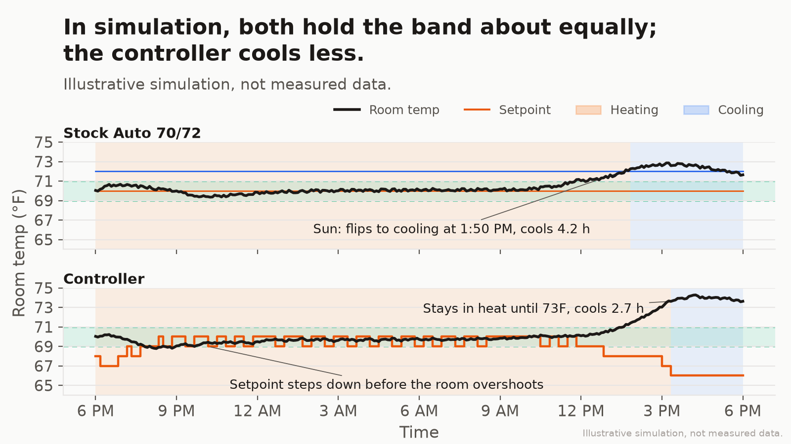
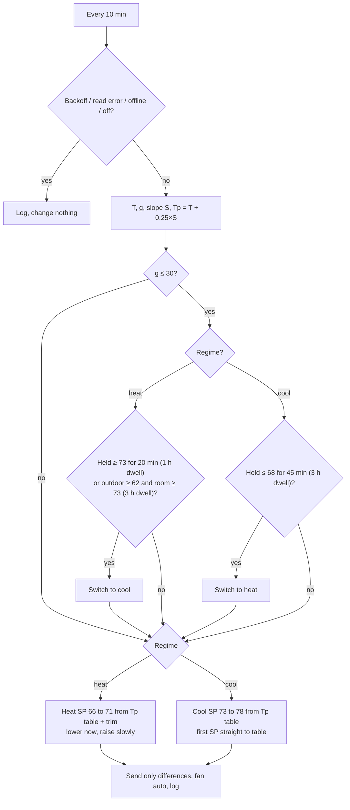
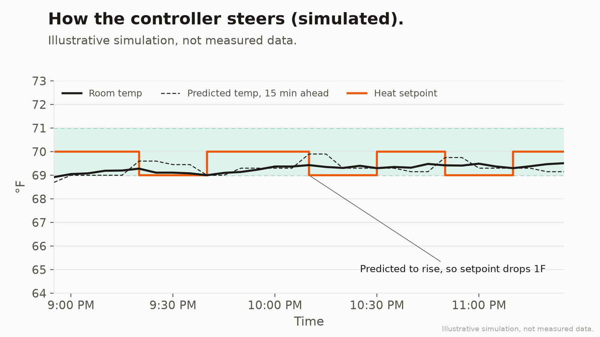
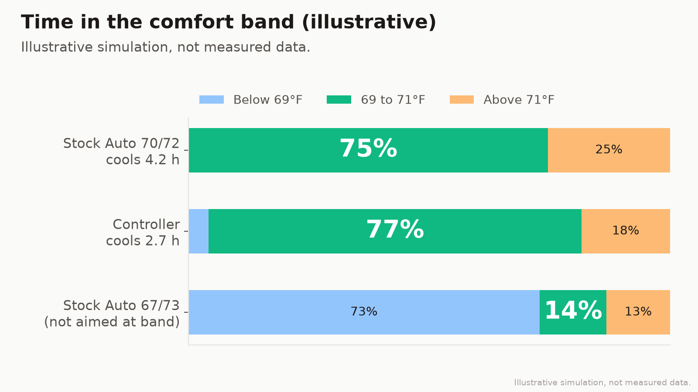

# Mitsubishi Mini-Split Controller

**A small controller that keeps a Mitsubishi mini-split in heat and steers its setpoint toward 70°F. In simulation it matches a band-aimed Stock Auto on time in band and cools less; it has not yet beaten the author's earlier version in a real trial.**



In the author's own trial, real logs showed that v2 (this controller) has not yet beaten v1 (an earlier heat/cool switching version) on time in band (roughly 44% vs 71%), and that strong afternoon sun pushed the room above the band.

## The problem

Mitsubishi's Auto mode keeps a heat setpoint and a cool setpoint and only changes mode when the room crosses the other one. A 67/73 Auto (the defaults `scripts/restore.sh` puts back) is not trying to hold a 69 to 71°F band at all: in the same simulation it spends 73% of the day below 69°F. A fair comparison sets Auto to 70/72, aimed at the band, and that is what Chart 1 shows. In that simulation both hold the band about equally (75% for Stock Auto, 77% for the controller); the difference is cooling. Stock Auto switches to cooling as soon as afternoon sun takes the room past 72°F and cools for 4.2 hours, while the controller stays in heat until the room holds 73°F and cools for 2.7 hours.

## How it works

The controller stays in heat and steers the heat setpoint between 66 and 71°F from a predicted room temperature 15 minutes ahead (Tp = current temp + 0.25 h × slope). It lowers the setpoint right away when Tp says the room is heading up, and raises it at most 1°F per 15 minutes. Every 3 hours it compares the time-weighted mean with the 70°F target and trims the whole table by 1°F if the mean drifted more than 0.4°F. It only cools when the room holds at or above 73°F for 20 minutes, which in practice means solar gain.

It runs every 10 minutes, sends only the settings that differ from the unit's live state, never touches the vane, never turns a switched-off unit back on, and writes one row per cycle to a CSV log.



T is the wireless sensor reading if it is at most 20 minutes old, else the unit's own reading. g is the number of minutes since the last good reading; after a gap longer than 30 minutes the controller still follows T but skips the slope, regime switches and trim.



## What to expect



Charts are a simulation that shows the behavior. Your results depend on your room, unit and climate.

The simulation (`scripts/simulate.py`) runs a simple one-room thermal model for 24 hours under the same outdoor temperature and sun curves twice. Both runs use the same modulating indoor unit (a PI loop with a minimum output that cycles off past its setpoint): once with Stock Auto at 70/72°F and its own changeover, and once driven by this controller's real decision code. Chart 3 adds a 67/73 Auto run for reference; it is not aimed at the band. The afternoon sun is calibrated so the controller run peaks near 74.3°F, the peak seen in the author's real log. The dynamics use no random numbers; the seed (42) only adds display noise, so `python scripts/make_charts.py` redraws identical charts every time.

Overnight the controller toggles its heat setpoint between 69 and 70°F about every 30 minutes, because the predicted temperature sits right on a table threshold. The unit only sees a 1°F nudge each time, so the room stays steady.

## Setup

### Hardware and sensor

* A Mitsubishi mini-split on a Kumo Cloud / Mitsubishi Comfort Wi-Fi adapter, set up in the Mitsubishi Comfort app.
* Recommended: a Mitsubishi wireless temperature sensor paired to the unit and placed where you sit. The controller uses the sensor when its reading is at most 20 minutes old and falls back to the unit otherwise.
* Any always-on machine with Python 3.11 or newer and internet access.

### Credentials and configuration

Install first (Python 3.11+). The `[charts]` extra adds matplotlib for `scripts/make_charts.py`; `[dev]` adds pytest too:

```bash
pip install -e .              # controller and the bundled Comfort client
pip install -e ".[charts]"    # optional: regenerate the charts
pip install -c constraints.txt -e ".[dev]"   # exact versions used for the tests and committed charts
```

Credentials only ever come from environment variables:

```bash
export MITSUBISHI_COMFORT_EMAIL="you@example.com"
export MITSUBISHI_COMFORT_PASSWORD="..."
python3 client/mitsubishi.py login      # stores tokens under ~/.config/mitsubishi (override: MITSUBISHI_CONFIG_DIR)
python3 client/mitsubishi.py status     # find your unit's serial or name
```

| Variable | Required | Meaning |
|---|---|---|
| `MITSUBISHI_COMFORT_EMAIL`, `MITSUBISHI_COMFORT_PASSWORD` | yes | Comfort app account; the password also enables automatic re-login when the refresh token expires |
| `MSC_DEVICE` | yes | Unit serial or name |
| `MSC_SENSOR_NAME` | no | Wireless sensor name, if the sensor is not linked to the unit |
| `MSC_LATITUDE`, `MSC_LONGITUDE` | no | Enables the outdoor temperature gate (Open-Meteo, no key needed). Without them the 73°F rule still works |
| `MSC_DATA_DIR` | no | Where `state.json`, `log.csv` and the heartbeat live (default `./var`) |
| `MSC_INTERVAL_S` | no | Seconds between cycles (default 600) |
| `MSC_TIMEZONE` | no | IANA zone for log timestamps (default `America/Los_Angeles`, labelled `PT`; other zones are labelled with their key, e.g. `UTC`) |
| `MSC_CLIENT_CMD` | no | Command that runs the Comfort client (default `python3 client/mitsubishi.py`) |
| `MSC_CONFIG` | no | TOML config file (default `./config.toml` if present) |

Every tuning value can also be set in a config file, and out-of-range values are rejected at startup; copy [`config.example.toml`](config.example.toml) to `config.toml`. Environment variables win over the file. See [`.env.example`](.env.example) for a template.

The controller writes its own log so you can chart your real results.

### Run and schedule

```bash
minisplit-controller --once --dry-run          # decide and print, change nothing
minisplit-controller --once                    # one real cycle
scripts/run_loop.sh                            # detached loop, every 10 min, pidfile + heartbeat in MSC_DATA_DIR
scripts/restore.sh                             # stop the loop and put the unit back on stock Auto 67/73
```

The loop sleeps in short chunks against the wall clock (it survives suspend and resume), caps each cycle with a watchdog, and logs a gap note when a cycle runs late. To start it at boot, use a systemd user service or `@reboot` cron entry that runs `scripts/run_loop.sh`.

### Log format

One row per cycle, plus an extra row for each regime, trim or setpoint change.

| Column | Meaning |
|---|---|
| `id` | Row number |
| `timestamp_pt` | Local time in `MSC_TIMEZONE` with a zone label (`YYYY-MM-DD 7:20 AM PT`) |
| `room_f` | Room temperature the controller used (°F) |
| `humidity` | Relative humidity reported by the unit (%) |
| `mode` | Unit mode after the cycle: `heat`, `cool`, `auto`, `off` |
| `auto_active` | In Auto mode, which side the unit was running (`heat` / `cool`); blank otherwise |
| `heat_sp`, `cool_sp` | Heat and cool setpoints on the unit (°F) |
| `fan` | Fan speed on the unit |
| `event` | `Reading` (no change), `Control change`, or `Error` |
| `action` | What happened. Cycle rows start with `outdoor ...; T ... Tp ... S ...F/h ... g ...m trim ... regime ...` and end with the changes sent |
| `room_c` | The unit's own room reading (°C) |
| `sensor_f` | Wireless sensor reading (°F), if available |
| `unit_f` | The unit's own room reading (°F) |
| `temp_source` | `sensor` or `unit`: which one `room_f` came from |
| `sensor_age_min` | Age of the sensor reading in minutes |

To chart your own log: `python scripts/make_charts.py --from-log var/log.csv --out charts` writes `log-timeline` and `log-time-in-band` (PNG and SVG) into `charts/`. Keep your log out of version control; it is under `var/`, which is git-ignored.

## Tuning

All values live in `[tuning]` in the config file.

**Heat setpoint table** (`heat_table`): Tp ≥ 70.6 → 66, ≥ 70.0 → 67, ≥ 69.4 → 68, ≥ 68.8 → 69, ≥ 68.2 → 70, else 71. Why these values: a mini-split heating in a small room overshoots its setpoint by a degree or more, so the setpoint has to sit below the target whenever the room is near it. Steps of 0.6°F in Tp map to 1°F of setpoint, which is the unit's own resolution, and the 66 to 71 range keeps it from ever blasting heat or shutting off for long.

**Cool setpoint table** (`cool_table`): Tp ≤ 71.4 → 78, ≤ 72.0 → 77, ≤ 72.6 → 76, ≤ 73.2 → 75, ≤ 73.8 → 74, else 73. Why: cooling exists only to take the edge off solar gain, so the setpoint backs off quickly as the room comes down rather than chasing 70°F and swinging the room cold.

**Rate limits** (`step_min = 15`): the risky direction (raising heat, lowering cool) moves 1°F per 15 minutes; the safe direction moves at once. Why: that is roughly how long the room takes to show the effect of a 1°F change, so faster steps would stack up before they could be measured.

**Trim limits** (`trim_every_h = 3`, `trim_deadband_f = 0.4`, `trim_min = -1`, `trim_max = 2`): every 3 hours, if at least 2.5 hours of readings exist and the mean is more than 0.4°F off target, shift the table by 1°F. Why: 3 hours is long enough to average out a heating cycle, the deadband keeps it from hunting, and the asymmetric limits allow more correction on cold nights (heat loss) than on mild days, where a lower setpoint risks underheating.

**The 73°F solar-gain rule** (`sun_override_f = 73`, `heat_to_cool_hold_min = 20`, `sun_dwell_h = 1`): switch to cool when the room holds at or above 73°F for 20 minutes, at least 1 hour after the last switch, whatever the outdoor temperature. Why this value: with the heat setpoint already at its floor, the only thing that pushes a room past 73°F is solar gain. 73 is 2°F above the band, far enough that heating overshoot alone does not reach it, and the 20-minute hold filters out a single warm reading. Going back to heat needs 68°F held for 45 minutes and a 3-hour dwell, so a short cloud does not cause a flip.

**Outdoor gate** (`outdoor_min_f = 62`): the other way into cool needs outdoor air at 62°F or warmer and a 3-hour dwell. Why: on a warm day the room can drift up without sun, and requiring warm outdoor air plus the full 3-hour dwell keeps a brief warm spell on a cold day from starting a cooling cycle. 62°F is a starting point; adjust it for your climate.

## Limitations and safety

* **Unofficial.** This project is not affiliated with or endorsed by Mitsubishi Electric. It uses the same cloud API as the Mitsubishi Comfort app, which is undocumented and can change or break at any time.
* **Cloud dependent.** Every reading and command goes through Mitsubishi's servers. If the cloud or your internet is down, the unit simply keeps its last settings. The client backs off when rate limited and re-logs in at most once per 10 minutes.
* **Conservative by design.** The controller never turns a unit on, never changes the vane, and leaves a switched-off or offline unit alone. Setpoints are clamped to 66 to 71°F for heat and 73 to 78°F for cool by default, and the config loader rejects values outside safe ranges.
* **Simulated charts.** The README charts come from a simulation, not measurements. Your room, unit and climate will differ, so tune and watch the log.
* **No warranty.** Use at your own risk; see the license.

The bundled client in [`client/mitsubishi.py`](client/mitsubishi.py) credits the open-source projects whose protocol notes it follows in its header.

## License

[MIT](LICENSE) © 2026 Chris Perish
